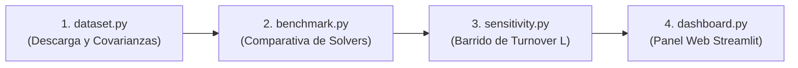

# OptiPort 📈
> **Optimización Convexa de Portafolios Multi-Período (MPO) con Solver Propio Primal-Dual (PDIPM)**

OptiPort es un framework cuantitativo para la optimización de portafolios de mínima varianza sujeto a restricciones de presupuesto de *turnover* (norma $L_1$) y costos de transacción cuadráticos/lineales. Incorpora un solver propio **Primal-Dual Interior-Point Method (PDIPM)** altamente optimizado mediante eliminación analítica de variables de holgura ($N \times N$), comparado contra solvers de referencia de la industria (**Clarabel/CVXPY** y **SLSQP/SciPy**).

---

## Guía de Ejecución Rápida (Pipeline)

El flujo de trabajo completo del proyecto se ejecuta secuencialmente en cuatro pasos:



### 1. Descarga y Preparación de Datos
Descarga los precios históricos de los constituyentes del S&P 500 (o S&P 100), limpia NaNs por umbral, genera los retornos del universo y del benchmark (SPY), y precalcula opcionalmente el caché de covarianzas rodantes con estimador shrinkage de Ledoit-Wolf.
```bash
python dataset.py
```
* **Opciones útiles:**
  * `--universe sp100` : Utiliza una selección de 100 activos en lugar de los ~500 del S&P 500.
  * `--refresh-universe` : Fuerza la recarga de constituyentes actualizados desde Wikipedia.
  * `--no-cov-cache` : No escribe el archivo binario `.npy` de covarianzas (se calcularán al vuelo).
* **Archivos generados:** `returns_sp500.csv`, `universe_sp500.csv`, `benchmark_spy.csv`, `rolling_data_sp500.npz` y `covs_sp500.npy`.

---

### 2. Benchmark de Solvers (3-Way Comparison)
Ejecuta la comparación entre el solver propio PDIPM estructurado, CVXPY (Clarabel) y SLSQP (SciPy) a lo largo del histórico de rebalanceos diarios. Mide precisión numérica, tiempos de convergencia y estabilidad de pesos.
```bash
python benchmark.py
```
* **Opciones útiles:**
  * `--max-days 60` : Ejecuta una muestra rápida de los primeros 60 días de rebalanceo.
  * `--solver generic` : Evalúa la versión PDIPM genérica ($2N+1$) como referencia.
  * `--with-slsqp` : Fuerza la ejecución de SLSQP incluso con $N \approx 500$ (precaución: significativamente lento).
* **Archivos generados:** `benchmark_3way_summary.csv`, `benchmark_3way_numeric.csv` y la gráfica `benchmark_3way_comparison.png`.

---

### 3. Análisis de Sensibilidad al Turnover ($L$)
Realiza un barrido sobre la grilla de presupuestos de turnover $L \in [0.01, 1.0]$ para evaluar el impacto en el Ratio de Sharpe neto de comisiones, drawdown máximo, volatilidad y arrastre de costos de transacción (*cost drag*).
```bash
python sensitivity.py
```
* **Opciones útiles:**
  * `--cost-bps 20` : Ajusta la tasa de costos de transacción (en puntos básicos, por ejemplo 20 bps).
  * `--init equal` : Selecciona portafolio equiponderado ($1/N$) para el inicio en vez de mínima varianza.
  * `--show` : Despliega la ventana gráfica interactiva de Matplotlib.
* **Archivos generados:** `sensibilidad_resultados.csv` y la figura comparativa `analisis_sensibilidad.png`.

---

### 4. Dashboard Interactivo
Inicia la aplicación interactiva en el navegador para explorar métricas cuantitativas institucionales, composición sectorial dinámica, frontera de sensibilidad y diagnóstico de convergencia del solver KKT.
```bash
streamlit run dashboard.py
```
* Abre automáticamente en `http://localhost:8501`.
* Incluye filtros interactivos de fechas, simulaciones al vuelo variando $L$ y comisiones, lágrimas mensuales (*monthly tearsheet*), drawdown dinámico y exportación de pesos/rendimientos en CSV.

---

## Instalación y Configuración del Entorno

### Requisitos Previos
* **Python 3.10 o 3.11** instalado.

### 1. Clonar el repositorio y acceder a la carpeta
```bash
git clone <URL_DEL_REPOSITORIO>
cd OptiPort
```

### 2. Crear y activar el entorno virtual
* **En Windows (PowerShell):**
  ```powershell
  python -m venv .venv
  .\.venv\Scripts\Activate.ps1
  ```
* **En Linux / macOS:**
  ```bash
  python3 -m venv .venv
  source .venv/bin/activate
  ```

### 3. Instalar dependencias
```bash
pip install --upgrade pip
pip install -r requirements.txt
```

### 4. (Opcional) Verificar la instalación con pruebas unitarias
Ejecuta el conjunto de pruebas matemáticas del solver estructurado con datos sintéticos (sin necesidad de conexión a internet):
```bash
python test_structured.py
```

---

## 📁 Estructura del Proyecto

```text
OptiPort/
├── config.py                 # Parámetros globales (fechas, universo, ventana, costos, solver)
├── dataset.py                # Adquisición de datos, limpieza y caché de Ledoit-Wolf
├── pdipm_qp_solver.py        # Solver PDIPM genérico con sistema KKT (2N+1)
├── pdipm_portfolio.py        # Solver PDIPM especializado con reducción analítica (N x N)
├── backtest_engine.py        # Motor de simulación sin sesgo temporal (look-ahead free)
├── benchmark.py              # Comparativa de solvers: PDIPM vs CVXPY vs SLSQP
├── sensitivity.py            # Barrido de parámetros de turnover L y costos
├── dashboard.py              # Aplicación web institucional en Streamlit
├── test_structured.py        # Pruebas unitarias y numéricas con datos sintéticos
├── requirements.txt          # Dependencias del proyecto
└── .gitignore                # Reglas de exclusión de git (venv, cachés, resultados)
```

---

##  Metodología Matemática y Computacional

### 1. Formulación del Problema Cuadrático (QP)
En cada período $t$, dado el vector de pesos tras la deriva de mercado $w_{drift, t}$, se resuelve:

$$\min_{w \in \mathbb{R}^N} \quad \frac{1}{2} w^T \Sigma_t w$$

$$\text{sujeto a:} \quad \mathbf{1}^T w = 1, \quad w \ge 0, \quad \|w - w_{drift, t}\|_1 \le 2 L$$

Donde:
* $\Sigma_t \in \mathbb{S}_{++}^N$ es la matriz de covarianza estimada por contracción (Ledoit-Wolf) sobre la ventana $[t-W, t)$.
* $L$ es el presupuesto unidireccional de turnover ($0.5 \|w - w_{drift}\|_1 \le L$).

### 2. Reducción Analítica del Sistema KKT (PDIPM Estructurado)
El solver estándar requiere resolver un sistema lineal $(2N+1) \times (2N+1)$ debido a las variables de holgura $u_i \ge |w_i - w_{drift, i}|$. 

Nuestro solver especializado (`pdipm_portfolio.py`) resuelve algebraicamente las direcciones de Newton para $u$ y los multiplicadores de Lagrange asociados, colapsando el sistema KKT a una dimensión de solo $N \times N$:
* **Factorización Cholesky optimizada:** Resolución simétrica definida positiva en lugar de sistemas indefinidos KKT aumentados.
* **Escalabilidad:** Permite resolver rebalanceos para el universo completo de $N \approx 500$ activos en menos de 10–25 ms por iteración diaria.
* **Sin sesgo de anticipación (*look-ahead bias*):** En el período $t$, se cobra el retorno de mercado con los pesos de apertura, se calcula la deriva del portafolio al cierre, y la estimación de $\Sigma$ utiliza estrictamente datos del pasado.
